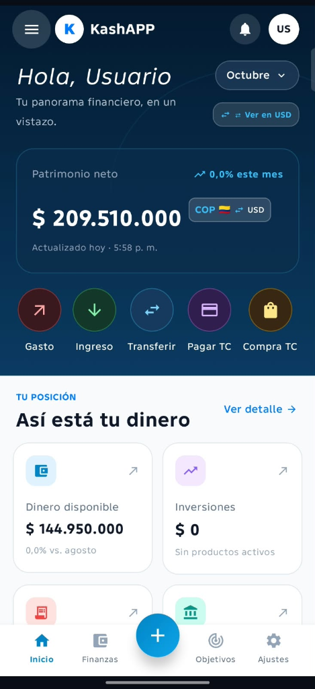
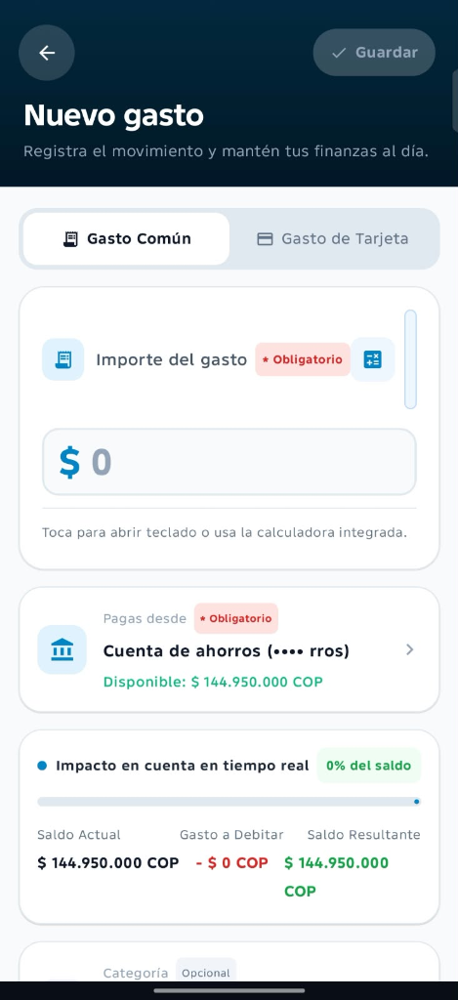
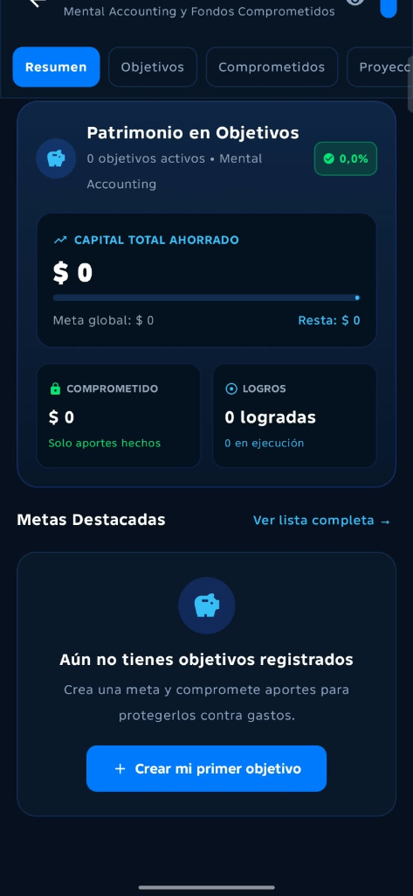
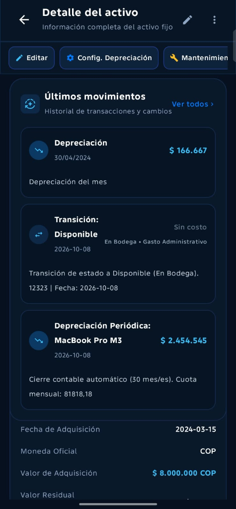
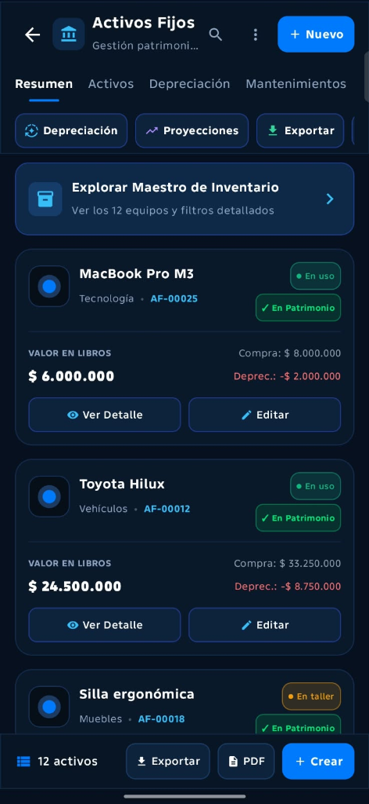
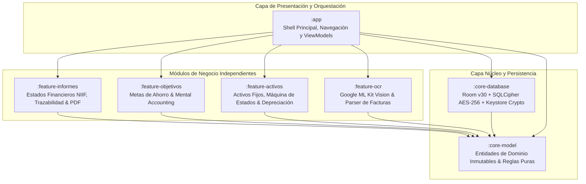
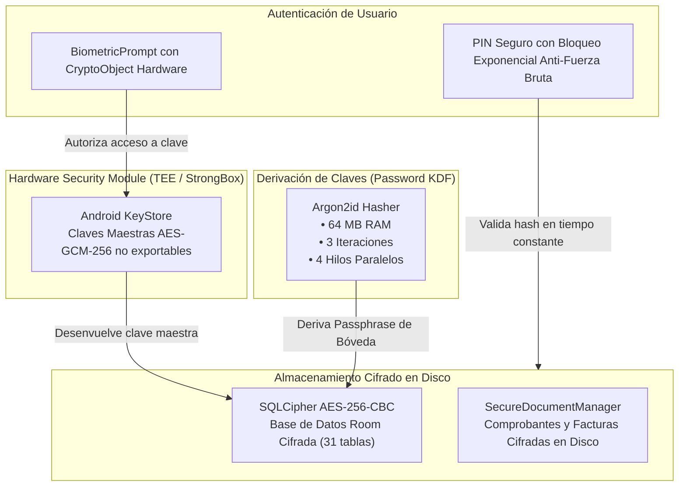

# 💎 KashApp — Enterprise Secure Financial & Asset Suite
### *Versión 7.9.0 | Grado Bancario & Estándar Contable NIIF/IFRS*

[-green.svg?style=for-the-badge&logo=android)](https://www.android.com/)
[](https://kotlinlang.org/)
[](https://developer.android.com/jetpack/compose)
[](https://developer.android.com/training/data-storage/room)
[-darkgreen.svg?style=for-the-badge)](https://developer.android.com/topic/architecture)
[](https://developer.android.com/training/articles/keystore)

**KashApp** es una solución móvil de gestión financiera personal y corporativa de alto rendimiento, diseñada con estándares fintech de grado bancario. Integra contabilidad formal bajo norma **NIIF / IFRS (NIC 16)**, cálculo automatizado de depreciaciones y cierres periódicos, trazabilidad patrimonial de activos fijos, presupuestación bajo el modelo de *Mental Accounting*, un asesor predictivo de gastos, escaneo inteligente de comprobantes mediante OCR y una arquitectura criptográfica multicapa respaldada por **SQLCipher AES-256** y **Android KeyStore**.

---

## 📸 Galería Visual del Sistema

<div align="center">
  <table>
    <tr>
      <td width="33%" align="center">
        <b>Dashboard Financiero en Tiempo Real</b><br/><br/>
        
        <p><i>Resumen patrimonial dinámico, conversión multimoneda (COP/USD), estado de liquidez y accesos directos a operaciones de caja y tarjetas.</i></p>
      </td>
      <td width="33%" align="center">
        <b>Registro y Simulación de Gastos</b><br/><br/>
        
        <p><i>Calculadora financiera integrada, validación de cupo y proyección en tiempo real del impacto en saldo antes de confirmar el movimiento.</i></p>
      </td>
      <td width="33%" align="center">
        <b>Objetivos & Fondos Comprometidos</b><br/><br/>
        
        <p><i>Arquitectura de fondos protegidos (Mental Accounting), planes de ahorro guiados, seguimiento de hitos y proyecciones de cumplimiento.</i></p>
      </td>
    </tr>
    <tr>
      <td width="50%" align="center">
        <b>Ficha Técnica de Activo Fijo (NIIF)</b><br/><br/>
        
        <p><i>Historial contable de depreciación periódica, transiciones de estado de custodia (En Bodega / En Uso) y valor residual oficial.</i></p>
      </td>
      <td width="50%" align="center">
        <b>Maestro de Inventario y Activos</b><br/><br/>
        
        <p><i>Control de activos categorizados (Tecnología, Vehículos, Muebles), valor en libros, depreciación acumulada y exportación a PDF.</i></p>
      </td>
    </tr>
  </table>
</div>

---

## 🏛️ Arquitectura Modular (7 Módulos Gradle)

El proyecto está diseñado bajo los principios de **Clean Architecture**, **Single Responsibility** y desacoplamiento estricto, estructurado en **7 módulos Gradle independientes**:



---

## 📦 Desglose Módulo por Módulo

### 1. `:app` — Shell de Navegación y Coordinación
* **Rol:** Orquestador principal de la experiencia de usuario y punto de entrada (`MainActivity`).
* **Componentes Clave:**
  * `DashboardScreen` y `DashboardViewModel`: Panel unificado de control financiero y patrimonial.
  * `AppContainer`: Inyección de dependencias centralizada de repositorios y casos de uso.
  * `AssetAiSuggestionEngine`: Motor de IA que analiza ciclos de vida de equipos y recomienda momentos óptimos de mantenimiento preventivo y desincorporación.
  * `FixedAssetNotificationHelper`: Gestor de alertas locales de Android para vencimientos de garantías, revisiones técnicas y seguros.

### 2. `:core-model` — Modelo de Dominio y Reglas Puras
* **Rol:** Núcleo de Kotlin puro sin dependencias del framework de Android ni bibliotecas de terceros.
* **Componentes Clave:**
  * Modelos inmutables de cuentas (`Account`), transacciones (`FinancialTransaction`), activos (`FixedAsset`) y presupuestos.
  * Tipado seguro de monedas (`CurrencyCode`), tipos de gasto e intervalos contables.
  * Operaciones financieras de alta precisión matemática sin pérdida de redondeo.

### 3. `:core-database` — Persistencia Cifrada con SQLCipher & Room v30
* **Rol:** Capa de almacenamiento local seguro con tolerancia a fallos.
* **Componentes Clave:**
  * `RoomLocalDb` (**Versión 30**): Esquema de base de datos relacional con 31 entidades y 11 DAOs.
  * `PRAGMA foreign_keys = ON;`: Activación obligatoria de integridad referencial para evitar registros huérfanos.
  * `MIGRATION_28_29` & `MIGRATION_29_30`: Migraciones incrementales automatizadas con índices de alto rendimiento (`index_accounts_userId` e índices de auditoría).
  * `AssetAuditLogDao` y `AssetAuditLogEntity`: Registro inmutable de auditoría para cada alteración contable o de custodia.
  * `PassphraseManager`: Generación y custodia de claves criptográficas utilizando el chip de seguridad (TEE/StrongBox) de Android.

### 4. `:feature-informes` — Suite Contable y Estados Financieros NIIF
* **Rol:** Módulo especializado en la emisión de reportes contables oficiales bajo estándares internacionales.
* **Componentes Clave:**
  * **Balance General** (`BalanceSheetModels`): Ecuación patrimonial formal ($\text{Activo} = \text{Pasivo} + \text{Patrimonio}$).
  * **Estado de Resultados / PyG** (`IncomeStatementModels`): Ingresos operacionales, costos directos, EBITDA y utilidad neta.
  * **Flujo de Caja** (`CashFlowModels`): Clasificación directa en Flujo de Operación, Inversión y Financiación.
  * **Estado de Cambios en el Patrimonio** (`EquityStatementModels`): Trazabilidad de aumentos de capital y utilidades retenidas.
  * `CalculationTraceEngine`: Motor de trazabilidad que explica paso a paso la fórmula y transacciones detrás de cada valor numérico en la UI.
  * `PredictiveExpenseEngine`: Algoritmo de proyección temporal de gastos recurrentes.
  * `PdfReportGenerator` & `FinancialReportExportEngine`: Generación nativa de balances en PDF con membrete profesional y tablas vectoriales.
  * `DocumentSupportManager`: Digitalización y custodia de facturas soporte.

### 5. `:feature-objetivos` — Asesor Inteligente de Metas y Fondos Comprometidos
* **Rol:** Motor de economía conductual (*Behavioral Economics*) y planificación financiera guiada.
* **Componentes Clave:**
  * `GoalContributionAdvisor`: Algoritmo que calcula el ahorro mensual ideal según el flujo libre de caja real del usuario.
  * `GoalProjectionEngine`: Simulación Monte Carlo y proyecciones de cumplimiento en el tiempo con impacto de inflación.
  * `GoalCommitmentEngine` & `GoalMilestoneEngine`: Bloqueo virtual de fondos (*Mental Accounting*) que evita gastar dinero destinado a metas críticas.
  * `RegisterContributionDialog`: Flujo ágil de capitalización de objetivos directo desde las cuentas bancarias registradas.

### 6. `:feature-activos` — Gestión Patrimonial y Depreciación NIIF (NIC 16)
* **Rol:** Control de inventario corporativo y activos fijos empresariales.
* **Componentes Clave:**
  * **Máquina de Estados de Custodia:** Transiciones formales de activos (`Disponible`, `En Uso`, `En Mantenimiento`, `Baja/Descarte`).
  * **Motor de Depreciación Automática:** Métodos contables soportados (Línea Recta, Suma de Dígitos de Años y Unidades Producidas).
  * Cálculo dinámico de Valor en Libros, Depreciación Acumulada y Valor Residual.
  * Cierre contable mensual programado con cuota de depreciación automática.

### 7. `:feature-ocr` — Visión Artificial y Procesamiento de Recibos
* **Rol:** Captura instantánea de gastos a partir de comprobantes impresos o digitales.
* **Componentes Clave:**
  * **Google ML Kit Text Recognition** (Latin script): Extracción óptica optimizada en el dispositivo sin enviar imágenes a servidores externos.
  * **Parser Inteligente de Facturas Colombianas y Latinoamericanas**: Detección heurística de fecha, número de factura/NIT, desglose de IVA y valor total a debitar.

---

## 🔒 Arquitectura de Seguridad Criptográfica Multicapa

KashApp fue construida desde sus cimientos bajo el principio de **Zero-Trust Local** y defensa en profundidad:



1. **Hardware Security Module (HSM):** Las llaves criptográficas principales residen en el Android KeyStore respaldado por hardware (StrongBox Keymaster), impidiendo su extracción incluso en dispositivos con acceso root.
2. **Derivación de Clave de Grado Militar:** El hashing de PIN y contraseñas implementa **Argon2id** (ganador del Password Hashing Competition), configurado con resistencia activa contra ataques masivos por GPU y FPGA.
3. **Cifrado en Reposo Completo:** Todas las tablas de Room residen dentro de una base de datos **SQLCipher** protegida mediante AES-256-CBC con HMAC-SHA1 de integridad por página.
4. **Bóveda con Prevención de Corrupción:** El subsistema de respaldo (`SecurityDatabase`) preserva las réplicas cifradas ante fallos transitorios de desbloqueo, garantizando cero pérdida de información contable.
5. **Autenticación Biométrica Verificable:** La huella dactilar se enlaza directamente a un `CryptoObject` criptográfico; no es un simple chequeo booleano de UI.

---

## 📊 Métricas de Ingeniería del Código

* **Total de Archivos:** 500 archivos
* **Archivos Kotlin (`.kt`):** 438 archivos
* **Líneas de Código Kotlin:** 115,819 líneas
* **Entidades Relacionales de Room:** 31 tablas
* **DAOs de Acceso a Datos:** 11 DAOs
* **Módulos Gradle:** 7 módulos
* **Cobertura de Pruebas Unitarias:** Motores de estados financieros, balance patrimonial, depreciación NIIF y transferencias atómicas.

---

## 🚀 Guía de Instalación y Ejecución Local

### Prerrequisitos
* **Android Studio:** Ladybug (2024.2.1) o superior.
* **JDK:** Java Development Kit 17 (OpenJDK 17).
* **Android SDK:** API Level 34 (Android 14) o superior.
* **Gradle:** 8.7+ con soporte de Gradle Wrapper.

### Pasos de Configuración

1. **Clonar el Repositorio:**
   ```bash
   git clone https://github.com/Andrewsscorp/KashAPP.git
   cd KashAPP
   ```

2. **Configurar Credenciales de Firebase (Desarrollo Local):**
   * Copia la plantilla de ejemplo de configuración en el módulo `:app`:
     ```bash
     cp app/google-services.json.example app/google-services.json
     ```
   * *Nota:* El archivo `app/google-services.json` real se encuentra estrictamente ignorado por `.gitignore` para proteger las credenciales y llaves de producción. Configura los parámetros de tu propio proyecto de Firebase Console si requieres sincronización en la nube.

3. **Configurar Variables de Entorno:**
   * Si utilizas los asistentes de inteligencia artificial, crea un archivo `.env` en la raíz del proyecto:
     ```properties
     GEMINI_API_KEY=tu_clave_de_gemini_api_aqui
     ```

4. **Compilar y Ejecutar:**
   * Abre el proyecto en Android Studio.
   * Espera a que termine la sincronización de Gradle (*Sync Project with Gradle Files*).
   * Conecta un dispositivo físico o inicia un emulador Android (API 26 o superior).
   * Presiona **Run** (`Shift + F10`) para desplegar la variante `debug`.

---

## 🛡️ Estricta Política de Privacidad y `.gitignore`

El repositorio implementa una política rigurosa de protección de secretos para garantizar que ningún dato sensible sea filtrado al control de versiones:
* ❌ **Ignorado:** Archivos de credenciales de Firebase (`google-services.json`, llaves de servicio de Firebase).
* ❌ **Ignorado:** Bases de datos de prueba, respaldos de SQLite y archivos de bóveda local (`*.db`, `*.sqlite`, `*.bak`, `*.vault`).
* ❌ **Ignorado:** Keystores, firmas de producción y certificados digitales (`*.jks`, `*.keystore`).
* ❌ **Ignorado:** Configuraciones locales y variables de entorno (`local.properties`, `.env`).

---

## 👨‍💻 Autor & Arquitectura

* **Desarrollador Principal & Arquitecto:** Andres Felipe Suarez ([@Andrewsscorp](https://github.com/Andrewsscorp))
* **Organización:** AndrewsCorp Engineering Team
* **Repositorio Oficial:** [https://github.com/Andrewsscorp/KashAPP](https://github.com/Andrewsscorp/KashAPP)

---
<div align="center">
  <sub>Desarrollado con pasión, estándares de ingeniería bancaria y diseño Material 3.</sub>
</div>
