# 💎 KashApp — Enterprise Secure Financial & Asset Suite
### *Versión 7.9.0 | Grado Bancario, Arquitectura Modular & Estándar Contable NIIF/IFRS*

[-green.svg?style=for-the-badge&logo=android)](https://www.android.com/)
[](https://kotlinlang.org/)
[](https://developer.android.com/jetpack/compose)
[](https://developer.android.com/training/data-storage/room)
[-darkgreen.svg?style=for-the-badge)](https://developer.android.com/topic/architecture)
[](https://developer.android.com/training/articles/keystore)

**KashApp** es una plataforma móvil empresarial de gestión patrimonial, finanzas personales y contabilidad corporativa bajo estándares internacionales **NIIF / IFRS (NIC 16)**. Diseñada con un enfoque de ingeniería bancaria y **Zero-Trust**, KashApp combina la máxima privacidad mediante **cifrado en reposo SQLCipher AES-256**, derivación de claves por **Argon2id**, custodia de llaves en **Android KeyStore por hardware**, escaneo inteligente de comprobantes con **Google ML Kit OCR**, contabilidad conductual (*Mental Accounting*) y una suite analítica completa de estados financieros oficiales.

---

## 📑 Tabla de Contenidos

1. [📸 Galería Visual de la Aplicación (10 Capturas de Pantalla)](#-galería-visual-de-la-aplicación)
2. [🏛️ Arquitectura Modular del Sistema (7 Módulos Gradle)](#️-arquitectura-modular-del-sistema)
3. [🔒 Arquitectura Criptográfica y Seguridad Profunda](#-arquitectura-criptográfica-y-seguridad-profunda)
4. [⚙️ Análisis Exhaustivo de Funcionalidades Principales](#️-análisis-exhaustivo-de-funcionalidades-principales)
   * [1. Dashboard Financiero Central y Posición Patrimonial](#1-dashboard-financiero-central-y-posición-patrimonial-global)
   * [2. Registro y Simulación de Gastos con Impacto en Tiempo Real](#2-registro-y-simulación-de-gastos-con-impacto-en-tiempo-real)
   * [3. Registro de Ingresos y Proyección de Liquidez](#3-registro-de-ingresos-y-proyección-de-liquidez-patrimonial)
   * [4. Transferencias Atómicas Interbancarias con Teclado Seguro](#4-transferencias-atómicas-interbancarias-con-teclado-seguro)
   * [5. Gestión de Tarjetas de Crédito, Cuotas y Abono Inteligente](#5-gestión-de-tarjetas-de-crédito-cuotas-y-abono-inteligente)
   * [6. Catálogo Maestro de Cuentas Patrimoniales](#6-catálogo-maestro-de-cuentas-y-estructuración-patrimonial)
   * [7. Mental Accounting, Metas de Ahorro y Fondos Comprometidos](#7-mental-accounting-metas-de-ahorro-y-fondos-comprometidos)
   * [8. Activos Fijos, Depreciación NIIF (NIC 16) y Máquina de Estados](#8-activos-fijos-depreciación-niif-nic-16-y-control-patrimonial)
   * [9. Escáner Inteligente de Facturas con Visión Artificial (OCR)](#9-escáner-inteligente-de-facturas-con-visión-artificial-ocr)
   * [10. Suite de Estados Financieros, Trazabilidad Contable e Informes PDF](#10-suite-de-estados-financieros-trazabilidad-contable-e-informes-pdf)
5. [📊 Diagramas de Procesos y Flujos Financieros](#-diagramas-de-procesos-y-flujos-financieros)
6. [📈 Métricas y Calidad del Código](#-métricas-y-calidad-del-código)
7. [🚀 Guía de Instalación y Ejecución Local](#-guía-de-instalación-y-ejecución-local)
8. [🛡️ Políticas de Privacidad y `.gitignore`](#️-políticas-de-privacidad-y-gitignore)
9. [👨‍💻 Autor y Créditos](#-autor-y-créditos)

---

## 📸 Galería Visual de la Aplicación

A continuación se exhibe el ecosistema visual de KashApp operando en un entorno de producción móvil:

<div align="center">
  <table>
    <tr>
      <td width="33%" align="center">
        <b>1. Dashboard Principal</b><br/><br/>
        <br/><br/>
        <p align="left"><i>Patrimonio neto global ($209.510.000 COP), indicador de liquidez disponible, conversión en tiempo real a USD y accesos rápidos de caja y crédito.</i></p>
      </td>
      <td width="33%" align="center">
        <b>2. Nuevo Gasto & Simulación</b><br/><br/>
        <br/><br/>
        <p align="left"><i>Calculadora financiera integrada, validación de cupo y proyección del impacto en cuenta en tiempo real antes de guardar el registro.</i></p>
      </td>
      <td width="33%" align="center">
        <b>3. Mental Accounting & Metas</b><br/><br/>
        <br/><br/>
        <p align="left"><i>Módulo de economía conductual para protección de fondos comprometidos, seguimiento de hitos y proyecciones de cumplimiento.</i></p>
      </td>
    </tr>
    <tr>
      <td width="33%" align="center">
        <b>4. Detalle de Activo Fijo (NIIF)</b><br/><br/>
        <br/><br/>
        <p align="left"><i>Ficha técnica con depreciación mensual automática (NIC 16), valor residual oficial y transiciones de estado de custodia (En Bodega / En Uso).</i></p>
      </td>
      <td width="33%" align="center">
        <b>5. Maestro de Activos Fijos</b><br/><br/>
        <br/><br/>
        <p align="left"><i>Inventario patrimonial categorizado (Tecnología, Vehículos, Mobiliario), semáforos de estado, valor en libros y exportación PDF.</i></p>
      </td>
      <td width="33%" align="center">
        <b>6. Menú Drawer de Navegación</b><br/><br/>
        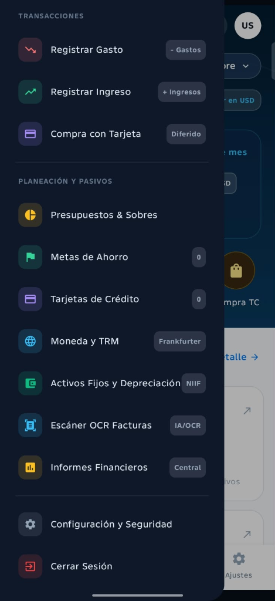<br/><br/>
        <p align="left"><i>Organización modular por dominios: Transacciones, Planeación y Pasivos, Monedas & TRM, Activos NIIF, Escáner OCR y Estados Financieros.</i></p>
      </td>
    </tr>
    <tr>
      <td width="33%" align="center">
        <b>7. Registro de Nuevo Ingreso</b><br/><br/>
        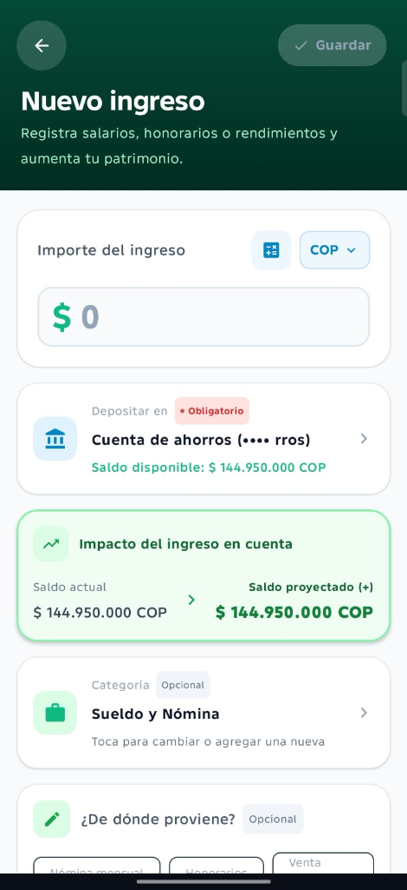<br/><br/>
        <p align="left"><i>Acreditación de salarios y dividendos, cálculo proyectado de saldo positivo, categorización contable y procedencia de fondos.</i></p>
      </td>
      <td width="33%" align="center">
        <b>8. Transferencias Atómicas</b><br/><br/>
        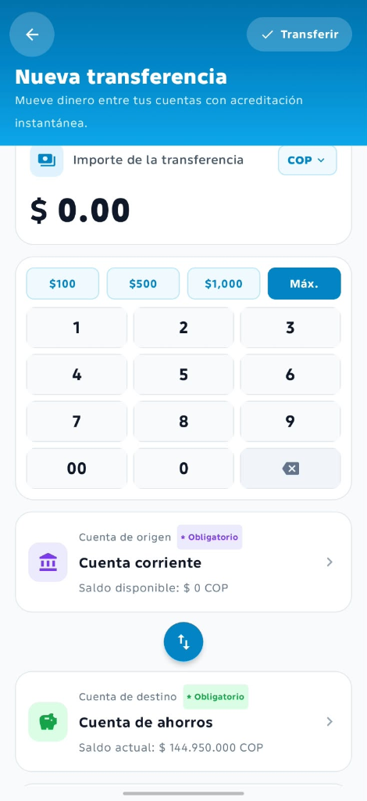<br/><br/>
        <p align="left"><i>Teclado numérico in-app seguro, botones de monto rápido ($100, $500, $1.000, Máx.), selector swap bidireccional y transacción atómica ACID.</i></p>
      </td>
      <td width="33%" align="center">
        <b>9. Pago Inteligente de Tarjeta</b><br/><br/>
        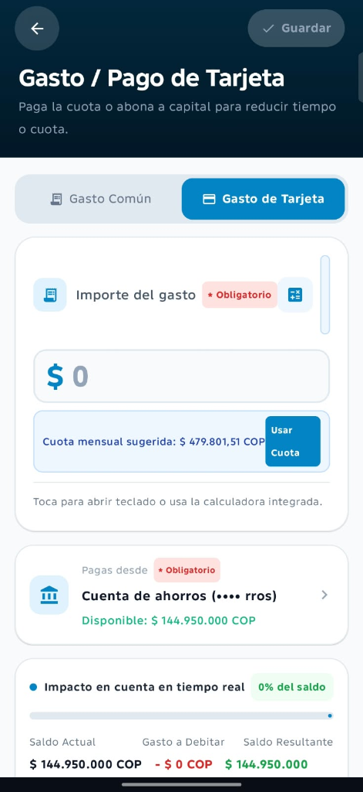<br/><br/>
        <p align="left"><i>Cálculo automatizado de cuota mensual sugerida ($479.801,51 COP), opción One-Tap 'Usar Cuota' y simulación del impacto en la liquidez bancaria.</i></p>
      </td>
    </tr>
    <tr>
      <td colspan="3" align="center">
        <b>10. Catálogo Maestro de Tipos de Cuentas Patrimoniales</b><br/><br/>
        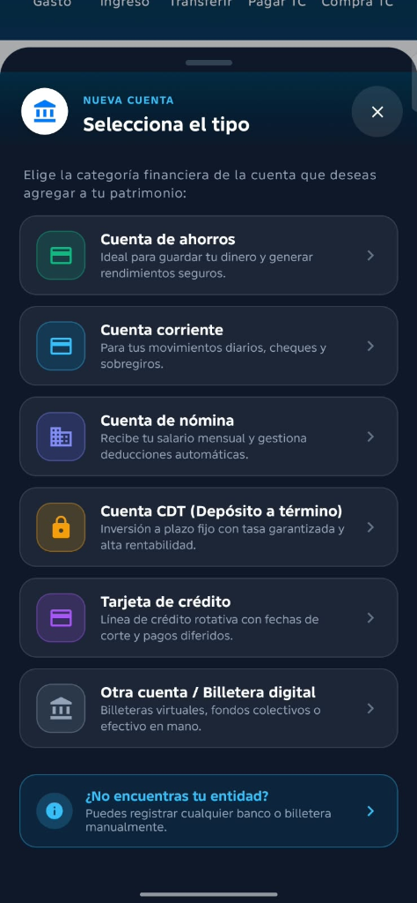<br/><br/>
        <p align="center"><i>Arquitectura de diversificación patrimonial: Cuentas de Ahorros, Corrientes, Nómina, Inversiones CDT, Tarjetas de Crédito y Billeteras Digitales.</i></p>
      </td>
    </tr>
  </table>
</div>

---

## 🏛️ Arquitectura Modular del Sistema

KashApp implementa una arquitectura modular desacoplada dividida en **7 módulos Gradle** bajo los preceptos de **Clean Architecture**, **MVI (Model-View-Intent)** y el principio de inversión de dependencias:

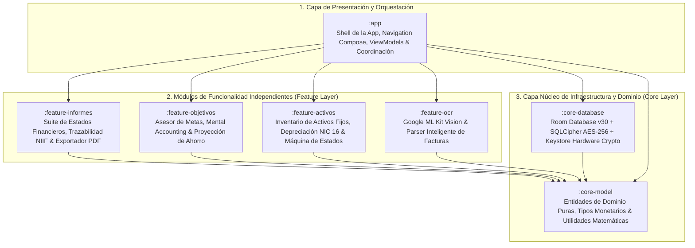

### Detalle de Responsabilidad por Módulo:

1. **`:app` (Shell y Orquestación):** Contiene el punto de entrada de Android (`MainActivity`), el grafo general de navegación, los ViewModels globales de la pantalla principal (`DashboardViewModel`), el motor de sugerencias asistido por IA (`AssetAiSuggestionEngine`) y las alarmas de mantenimiento (`FixedAssetNotificationHelper`).
2. **`:core-model` (Dominio Puro):** Módulo de Kotlin puro sin dependencias de Android. Define las entidades inmutables (`Account`, `FinancialTransaction`, `FixedAsset`, `FinancialReport`), interfaces de repositorio y modelos matemáticos monetarios de alta precisión.
3. **`:core-database` (Persistencia Cifrada):** Implementa la base de datos relacional Room en su **versión 30**, operando sobre el motor criptográfico **SQLCipher**. Contiene 31 tablas, 11 DAOs, migraciones ordenadas (v28 $\rightarrow$ v29 $\rightarrow$ v30), la activación obligatoria de claves foráneas (`PRAGMA foreign_keys = ON;`) y la tabla de auditoría `asset_audit_logs`.
4. **`:feature-activos` (Activos Fijos NIIF):** Módulo de contabilidad patrimonial física bajo estándar NIC 16. Implementa el cálculo de depreciación por Línea Recta y Saldos Decrecientes, el calendario de amortización periódica y la máquina de estados de custodia de bienes.
5. **`:feature-ocr` (Reconocimiento Óptico de Comprobantes):** Procesa imágenes capturadas por cámara o galería mediante **Google ML Kit Vision**. Contiene un analizador léxico y heurístico adaptado al formato de facturas y tiquetes POS en Colombia y Latinoamérica.
6. **`:feature-informes` (Estados Financieros & Informes):** Genera en tiempo real los cuatro estados financieros oficiales (Balance General, PyG, Flujo de Caja y Cambios en el Patrimonio), implementa el motor de explicación paso a paso (`CalculationTraceEngine`) y produce reportes formales en PDF.
7. **`:feature-objetivos` (Metas y Mental Accounting):** Motor de finanzas conductuales que calcula planes de ahorro viables según la liquidez disponible (`GoalContributionAdvisor`), monitorea hitos de avance y bloquea virtualmente fondos para evitar desviaciones de presupuesto.

---

## 🔒 Arquitectura Criptográfica y Seguridad Profunda

La seguridad en KashApp no es un complemento superficial; es el pilar estructural que rige cada lectura y escritura en almacenamiento local. La aplicación asume un modelo **Zero-Trust en el Dispositivo**, donde los datos están protegidos contra extracción física, volcados de memoria y accesos no autorizados en dispositivos rooteados.

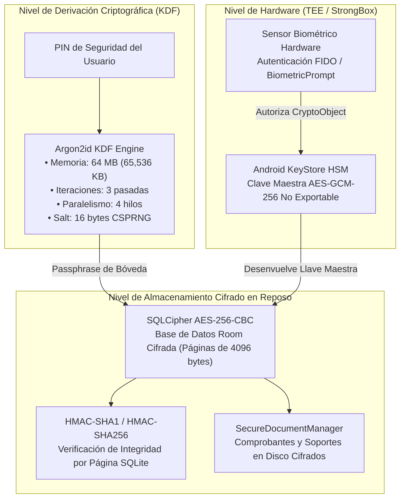

### 1. Función de Derivación de Clave: Argon2id de Grado Militar
Para proteger el PIN y las claves maestras contra ataques de fuerza bruta asistidos por clusters de GPU o chips ASIC, KashApp utiliza **Argon2id** (ganador del certamen internacional *Password Hashing Competition*):
* **Parámetros Computacionales:** Configurado con **64 MB de memoria RAM obligatoria** ($m=65536$), **3 iteraciones temporales** ($t=3$) y **4 hilos paralelos** ($p=4$).
* **Resistencia a Canales Laterales:** Argon2id combina la resistencia contra ataques de canal lateral basada en caché de Argon2i con la inmunidad contra ataques de paralelismo masivo de Argon2d.
* **Comparación en Tiempo Constante:** Las verificaciones de hash emplean algoritmos de tiempo constante (`MessageDigest.isEqual`), mitigando cualquier vulnerabilidad por análisis de tiempos de respuesta (*timing attacks*).

### 2. Android KeyStore y Hardware Security Module (HSM)
* **Claves No Exportables:** Las llaves criptográficas de nivel maestro se generan dentro del chip de seguridad físico del dispositivo (**TEE - Trusted Execution Environment** o **StrongBox Keymaster**). Las claves privadas jamás ingresan al espacio de memoria del sistema operativo Android y no pueden ser extraídas mediante depuradores ni privilegios de superusuario (*root*).
* **Algoritmo de Bloqueo:** Cifrado simétrico autenticado **AES-GCM de 256 bits** con vector de inicialización aleatorio de 12 bytes y etiqueta de autenticación (Auth Tag) de 128 bits para prevenir manipulaciones maliciosas del payload.

### 3. Cifrado de Base de Datos con SQLCipher AES-256-CBC
* **Cifrado de Bloque por Página:** Todas las 31 tablas de Room residen en un archivo cifrado en su totalidad mediante **SQLCipher**. Cada página física de 4096 bytes se cifra de forma independiente utilizando AES-256 en modo CBC con un vector de inicialización único.
* **Integridad Garantizada por HMAC:** Cada página incluye una firma digital HMAC-SHA1 calculada antes de la escritura en disco. Si un atacante altera un solo bit del archivo en almacenamiento flash, la base de datos detecta la corrupción inmediatamente y rechaza la conexión, impidiendo ataques de inyección de código binario.

### 4. Bóveda Multi-Nivel y Recuperación ante Desastres
* **Arquitectura de Bóveda Tiered (Tier 1a / Tier 1b):** Implementada en [`SecurityDatabase.kt`](file:///C:/Users/Hawk/Documents/AppsFinanzas/kashapp-secure-auth%20V7.9/core-database/src/main/java/com/example/data/local/SecurityDatabase.kt), gestiona la apertura segura y los respaldos preventivos.
* **Preservación Inmune a Corrupción:** Ante un fallo temporal de desbloqueo criptográfico, el sistema **no destruye** las copias de seguridad `.bak`. La bóveda conserva los archivos intactos y eleva un evento controlado a la interfaz de usuario, eliminando el riesgo de pérdida de datos por cierres forzados del sistema.

### 5. Autenticación Biométrica Verificable por Hardware
* **Integración con `CryptoObject`:** La autenticación por huella dactilar no se limita a evaluar un resultado booleano en la interfaz. El sensor biométrico alimenta directamente un objeto `BiometricPrompt.CryptoObject(cipher)`, el cual solo autoriza el descifrado de la clave en el KeyStore si la identidad biométrica es validada exitosamente por el enclave de hardware seguro.

---

## ⚙️ Análisis Exhaustivo de Funcionalidades Principales

Cada una de las funciones centrales de KashApp fue construida con una estricta coherencia contable, arquitectónica y visual. A continuación se desglosan en detalle:

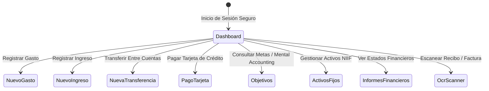

---

### 1. Dashboard Financiero Central y Posición Patrimonial Global

#### Visión Contable y Agregación Patrimonial
El Dashboard central consolida la posición financiera neta del usuario en tiempo real bajo la ecuación contable:
$$\text{Patrimonio Neto} = \sum \text{Activos Corrientes (Cuentas)} + \sum \text{Activos No Corrientes (Bienes NIIF)} - \sum \text{Pasivos (Tarjetas y Deudas)}$$
Permite visualizar la cifra en pesos colombianos (**COP**) o dólares estadounidenses (**USD**) mediante un selector interactivo en la cabecera. La conversión de divisas se actualiza a través de un servicio de tipo de cambio en tiempo real (**TRM Frankfurter API**), manteniendo sincronizadas todas las posiciones de inversión, cuentas bancarias y pasivos sin desfases monetarios.

#### Arquitectura de Estado Reactivo y Rendimiento
Implementado sobre [`DashboardViewModel.kt`](file:///C:/Users/Hawk/Documents/AppsFinanzas/kashapp-secure-auth%20V7.9/app/src/main/java/com/example/presentation/dashboard/DashboardViewModel.kt) y [`DashboardScreen.kt`](file:///C:/Users/Hawk/Documents/AppsFinanzas/kashapp-secure-auth%20V7.9/app/src/main/java/com/example/presentation/dashboard/DashboardScreen.kt), el panel consume flujos reactivos de Kotlin (`StateFlow` y `SharedFlow`) vinculados a los DAOs de Room. Cuando cualquier módulo registra un gasto, una depreciación de activo o un abono a tarjeta, el flujo emite una nueva instantánea del estado patrimonial que se propaga instantáneamente a la interfaz gráfica. Los componentes de Jetpack Compose utilizan claves de estabilidad (`remember` y `derivedStateOf`) para evitar recomposiciones innecesarias, logrando una tasa de renderizado constante a 60/120 FPS.

#### Experiencia de Usuario y Accesos Rápidos
La interfaz presenta una tarjeta principal con el patrimonio total destacado en tipografía de alto contraste, acompañada de semáforos de liquidez y un desglose de dinero disponible frente a inversiones activas. Debajo del panel principal se sitúa una hilera de accesos directos (*Quick Actions*) con botones táctiles dedicados para: **Gasto**, **Ingreso**, **Transferir**, **Pagar TC** y **Compra TC**. En la parte inferior, una barra de navegación integrada (*Bottom Navigation Bar*) permite alternar sin latencia entre Inicio, Finanzas, el botón flotante central de captura rápida (`+`), Objetivos y Ajustes.

---

### 2. Registro y Simulación de Gastos con Impacto en Tiempo Real

#### Lógica Financiera y Débito Inmediato
El módulo de registro de egresos procesa salidas de dinero bajo dos modalidades formales: **Gasto Común** (débito instantáneo de cuentas de ahorro, corriente o efectivo) y **Gasto de Tarjeta** (consumo diferido a cuotas sobre una línea de crédito rotativa). Cada egreso descuenta inmediatamente el saldo de la cuenta de origen seleccionada y actualiza el balance consolidado, garantizando que el usuario jamás visualice saldos desactualizados o fondos fantasma.

#### Simulador Interactivo de Saldo en Vivo
Una de las innovaciones más destacadas de la interfaz es el componente de **Impacto en Cuenta en Tiempo Real** ([`CreateExpenseScreen.kt`](file:///C:/Users/Hawk/Documents/AppsFinanzas/kashapp-secure-auth%20V7.9/app/src/main/java/com/example/presentation/expense/CreateExpenseScreen.kt)). A medida que el usuario digita un importe en el teclado, el sistema recalcula en tiempo real tres valores clave: el **Saldo Actual**, el **Gasto a Debitar** y el **Saldo Resultante proyectado**, acompañados de un medidor porcentual que indica qué fracción de la liquidez total de la cuenta se consumirá con la operación. Esto previene sobregiros involuntarios y brinda retroalimentación psicológica inmediata antes de comprometer el dinero.

#### Calculadora Integrada y Selección Heurística
La pantalla incorpora un botón de calculadora financiera (`+`, `-`, `*`, `/`) junto al campo de importe, permitiendo calcular subtotales o repartir gastos directamente en la vista sin necesidad de salir a una aplicación externa. Dispone además de un selector contextual de cuentas bancarias con indicación del disponible actual, un catálogo de categorías personalizables (Alimentación, Transporte, Servicios, Entretenimiento) y la posibilidad de adjuntar la fotografía digitalizada del comprobante de pago capturada por la cámara.

---

### 3. Registro de Ingresos y Proyección de Liquidez Patrimonial

#### Naturaleza del Flujo de Entrada y Capitalización
La pantalla de nuevo ingreso ([`CreateIncomeScreen.kt`](file:///C:/Users/Hawk/Documents/AppsFinanzas/kashapp-secure-auth%20V7.9/app/src/main/java/com/example/presentation/income/CreateIncomeScreen.kt)) formaliza las acreditaciones de capital hacia las cuentas del usuario, ya sea por concepto de salarios de nómina, honorarios profesionales, dividendos de inversión, rendimientos financieros de CDTs o ventas extraordinarias. Cada ingreso incrementa la disponibilidad inmediata de fondos y aporta directamente a la base de cálculo del patrimonio neto.

#### Proyección de Crecimiento y Salud Financiera
De forma simétrica al registro de gastos, el sistema proyecta en pantalla verde el impacto positivo del ingreso sobre la cuenta receptora: se muestra el **Saldo Actual**, la flecha de transición hacia el **Saldo Proyectado (+)** y la cuenta destino elegida. Esta información nutre directamente el motor de flujo libre de caja (`CashFlowModels`), permitiendo al usuario saber si el nuevo ingreso cubre los compromisos pendientes de tarjetas o si puede derivarse a las metas de ahorro activas.

#### Interfaz Guiada y Metadatos de Origen
La vista incluye selectores rápidos de procedencia mediante chips interactivos (*"Nómina mensual"*, *"Honorarios"*, *"Venta ocasional"*), un selector de moneda multiactivo (COP/USD) y un campo para observaciones detalladas. Al presionar el botón *"Guardar"*, los datos se validan atómicamente, se almacena el movimiento en la tabla `financial_transactions` y se emite una notificación de sincronización a la vista principal.

---

### 4. Transferencias Atómicas Interbancarias con Teclado Seguro

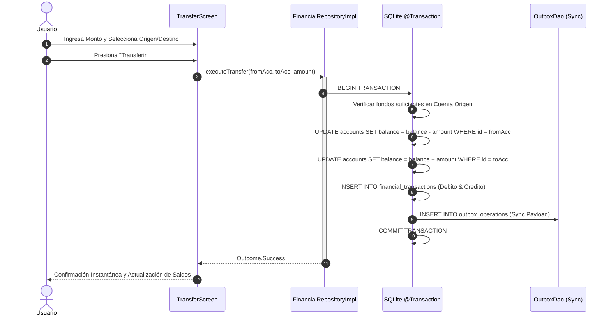

#### Atomicidad Transaccional Completa (`@Transaction`)
Las transferencias entre cuentas patrimoniales ([`CreateTransferScreen.kt`](file:///C:/Users/Hawk/Documents/AppsFinanzas/kashapp-secure-auth%20V7.9/app/src/main/java/com/example/presentation/transfer/CreateTransferScreen.kt)) se procesan bajo el estricto protocolo ACID de SQLite. Mediante el caso de uso [`CreateTransferUseCase.kt`](file:///C:/Users/Hawk/Documents/AppsFinanzas/kashapp-secure-auth%20V7.9/app/src/main/java/com/example/domain/usecase/CreateTransferUseCase.kt), el débito en la cuenta de origen y el crédito en la cuenta receptora se ejecutan dentro de una sola transacción atómica en Room. Si ocurre cualquier fallo inesperado, el sistema ejecuta un rollback automático, garantizando que el dinero jamás desaparezca ni quede en un estado intermedio inconsistente.

#### Teclado Numérico In-App Seguro y Anti-Keylogger
A diferencia de las aplicaciones convencionales que despliegan el teclado virtual predeterminado del sistema operativo (el cual puede estar sujeto a espionaje por aplicaciones de telemetría o keyloggers de terceros), KashApp renderiza un **teclado numérico in-app seguro**. Este teclado incluye botones de inyección rápida de capital (**$100**, **$500**, **$1.000** y botón **Máx.** para transferir el total disponible), una cuadrícula numérica con botón de doble cero (`00`) y un selector interactivo flotante con flechas bidireccionales (*Swap*) que permite intercambiar origen y destino con un solo toque.

#### Validación de Límites y Trazabilidad
Antes de autorizar la transacción, el sistema valida que la cuenta de origen cuente con saldo suficiente (a menos que admita sobregiro pactado), rechaza importes menores o iguales a cero y audita la operación registrando un identificador único de comprobante junto a la estampa de tiempo en UTC.

---

### 5. Gestión de Tarjetas de Crédito, Cuotas y Abono Inteligente

#### Modelado Financiero de Pasivos Rotativos
El módulo de tarjetas de crédito ([`CreditCardsScreen.kt`](file:///C:/Users/Hawk/Documents/AppsFinanzas/kashapp-secure-auth%20V7.9/app/src/main/java/com/example/presentation/credit_cards/CreditCardsScreen.kt)) gestiona pasivos revolventes con un alto nivel de detalle contable. Registra el cupo total otorgado por la entidad bancaria, el saldo utilizado a la fecha, el cupo disponible remanente, las tasas de interés nominal mes vencido (N.M.V.) y efectivo anual (E.A.), así como las fechas de corte de extracto y fechas límite de pago para evitar cobros por mora.

#### Sugerencia de Cuota y Abonos Dirigidos
Al acceder a la pantalla de pago de tarjeta ([`Gasto / Pago de Tarjeta`](file:///C:/Users/Hawk/Documents/AppsFinanzas/kashapp-secure-auth%20V7.9/app/src/main/java/com/example/presentation/expense/CreateExpenseScreen.kt)), el motor financiero analiza los diferidos vigentes y despliega una tarjeta azul destacada con la **Cuota Mensual Sugerida** (por ejemplo, *$ 479.801,51 COP*). Mediante el botón integrado **"Usar Cuota"**, el usuario puede poblar el campo de importe con la cuota exacta sugerida con un solo toque, o ingresar un valor personalizado para realizar un abono extraordinario a capital que reduzca el plazo o los intereses futuros de la deuda.

#### Impacto en Liquidez y Desendeudamiento
La interfaz calcula en vivo el efecto del pago sobre la cuenta de ahorros o corriente desde donde se debita el dinero, mostrando el porcentaje del saldo que se consumirá. Una vez aprobado el pago, el sistema reduce el pasivo en el balance general, restablece el cupo disponible en la tarjeta de crédito y registra el asiento contable de cancelación de deuda.

---

### 6. Catálogo Maestro de Cuentas y Estructuración Patrimonial

#### Diversificación de Instrumentos Financieros
El catálogo maestro ([`AccountSelectionDialog.kt`](file:///C:/Users/Hawk/Documents/AppsFinanzas/kashapp-secure-auth%20V7.9/app/src/main/java/com/example/presentation/dashboard/)) clasifica las cuentas patrimoniales del usuario en 6 categorías financieras estandarizadas:
1. **Cuenta de Ahorros:** Orientada a la custodia de fondos líquidos y generación de rendimientos seguros.
2. **Cuenta Corriente:** Destinada a transacciones diarias, emisión de cheques y soporte de sobregiros controlados.
3. **Cuenta de Nómina:** Especializada en la recepción de salarios y gestión de deducciones legales automáticas.
4. **Cuenta CDT (Depósito a Término Fijo):** Vehículo de inversión a plazo determinado con tasa pactada y rendimiento garantizado.
5. **Tarjeta de Crédito:** Línea de crédito rotativa para financiación a cuotas.
6. **Billetera Digital / Efectivo:** Fondos en plataformas móviles (Nequi, Daviplata) o efectivo físico disponible.

#### Reglas de Negocio Diferenciadas por Instrumento
Cada tipo de cuenta opera con reglas de negocio específicas. Las cuentas CDT, por ejemplo, calculan rendimientos acumulados con retención en la fuente y bloquean retiros antes de la fecha de vencimiento; las tarjetas de crédito aplican intereses según el número de cuotas de cada compra; y las cuentas de nómina se conectan con el worker de automatización de pagos periódicos (`PayrollAutomationWorker`).

#### Enmascaramiento Seguro y Flexibilidad de Registro
Los números de cuenta se protegen en la interfaz mediante enmascaramiento visual de seguridad (ejemplo: `•••• rros`), mostrando únicamente los últimos dígitos para evitar miradas indiscretas. Si el usuario posee una cuenta en una cooperativa o entidad no listada, el banner inferior *"¿No encuentras tu entidad?"* permite crear y parametrizar bancos y billeteras de forma manual sin restricciones.

---

### 7. Mental Accounting, Metas de Ahorro y Fondos Comprometidos

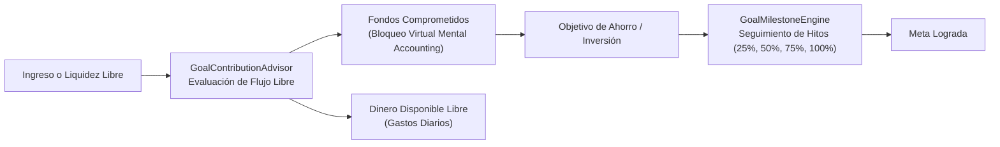

#### Economía Conductual y Protección de Fondos (*Mental Accounting*)
Inspirado en la teoría económica del Premio Nobel Richard Thaler, el módulo `:feature-objetivos` implementa el principio de **Contabilidad Mental**. El usuario puede definir metas específicas (ejemplo: fondo de emergencia, viaje, cuota inicial de vivienda) y comprometer aportes periódicos. El sistema aísla visual y financieramente estos recursos como **Fondos Comprometidos**, protegiéndolos de gastos impulsivos aunque el dinero continúe físicamente en la misma cuenta bancaria.

#### Motores de Decisión: Proyecciones e Hitos de Ahorro
* **`GoalContributionAdvisor`:** Examina el flujo de caja histórico y recomienda un aporte mensual matemáticamente sostenible que no asfixie la liquidez inmediata del usuario.
* **`GoalProjectionEngine`:** Simula diferentes curvas temporales de cumplimiento considerando aportes regulares, depósitos extraordinarios e indexación por inflación.
* **`GoalMilestoneEngine`:** Descompone metas a largo plazo en hitos secuenciales alcanzables (25%, 50%, 75% y 100%), motivando la constancia del ahorro mediante recompensas visuales de avance.

#### Interfaz de Capitalización y Panel de Logros
La pantalla de objetivos ([`ObjetivosScreen.kt`](file:///C:/Users/Hawk/Documents/AppsFinanzas/kashapp-secure-auth%20V7.9/feature-objetivos/src/main/java/com/example/feature/objetivos/ui/ObjetivosScreen.kt)) se estructura en 4 pestañas: *Resumen*, *Objetivos*, *Comprometidos* y *Proyecciones*. Incluye el diálogo interactivo [`RegisterContributionDialog.kt`](file:///C:/Users/Hawk/Documents/AppsFinanzas/kashapp-secure-auth%20V7.9/feature-objetivos/src/main/java/com/example/feature/objetivos/ui/dialogs/RegisterContributionDialog.kt), que permite transferir capital desde cualquier cuenta bancaria hacia la meta con actualización instantánea de la barra de progreso y el monto restante por ahorrar.

---

### 8. Activos Fijos, Depreciación NIIF (NIC 16) y Control Patrimonial

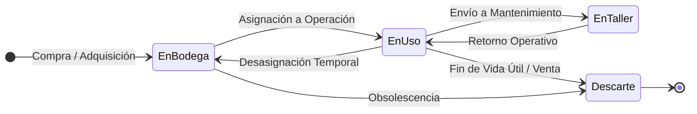

#### Estándar Contable Internacional (NIC 16)
El módulo `:feature-activos` profesionaliza el control de propiedades, planta y equipo. Cada bien físico registrado (equipos de computación como *MacBook Pro M3*, vehículos como *Toyota Hilux*, mobiliario de oficina) almacena su valor de adquisición oficial, fecha de compra, moneda oficial (COP/USD), vida útil contractual estimada en meses y **Valor Residual** garantizado.

#### Motores de Depreciación y Cierres Contables Periódicos
El motor [`DepreciationEngine.kt`](file:///C:/Users/Hawk/Documents/AppsFinanzas/kashapp-secure-auth%20V7.9/feature-activos/src/main/java/com/example/feature/activos/calculator/DepreciationEngine.kt) calcula automáticamente el desgaste contable mediante el método de **Línea Recta**:
$$\text{Cuota Mensual} = \frac{\text{Valor de Adquisición} - \text{Valor Residual}}{\text{Vida Útil en Meses}}$$
$$\text{Valor en Libros} = \text{Valor de Adquisición} - \text{Depreciación Acumulada}$$
El sistema ejecuta cierres contables periódicos automatizados (por ejemplo: depreciación periódica de 30 meses con cuota fija de $81.818,18 COP), actualizando el valor en libros sin intervención manual y registrando el asiento de gasto contable correspondiente en la tabla de transacciones.

#### Máquina de Estados de Custodia, Auditoría e IA
Los activos transitan formalmente a través de una **Máquina de Estados Finita**: `Disponible (En Bodega)`, `En Uso`, `En Taller (Mantenimiento)` y `Baja/Descarte`. Cada cambio de estado queda registrado en la tabla `asset_audit_logs` con estampa de tiempo, usuario y costo asociado. Además, el motor de inteligencia artificial [`AssetAiSuggestionEngine.kt`](file:///C:/Users/Hawk/Documents/AppsFinanzas/kashapp-secure-auth%20V7.9/app/src/main/java/com/example/presentation/fixedassets/ai/AssetAiSuggestionEngine.kt) analiza el valor en libros remanente y emite recomendaciones proactivas de reemplazo tecnológico o mantenimiento preventivo.

---

### 9. Escáner Inteligente de Facturas con Visión Artificial (OCR)

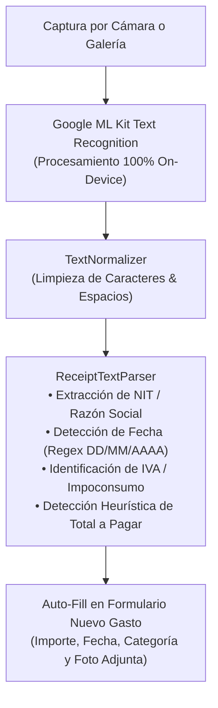

#### Procesamiento 100% Local en el Dispositivo (On-Device Vision)
El módulo `:feature-ocr` integra la biblioteca de visión computacional **Google ML Kit Text Recognition** para alfabeto latino. Todo el procesamiento de imágenes, segmentación de bloques de texto y reconocimiento de caracteres se ejecuta íntegramente en la CPU/GPU del dispositivo móvil, sin subir fotografías de facturas a servidores en la nube. Esto garantiza privacidad total y permite digitalizar comprobantes en zonas sin cobertura de internet.

#### Parser Heurístico de Facturación Colombiana y Latinoamericana
El analizador sintáctico [`ReceiptTextParser.kt`](file:///C:/Users/Hawk/Documents/AppsFinanzas/kashapp-secure-auth%20V7.9/feature-ocr/src/main/java/com/example/feature/ocr/parser/ReceiptTextParser.kt) implementa expresiones regulares avanzadas calibradas específicamente con las estructuras de facturación electrónica y tiquetes POS de la región. El algoritmo rastrea e identifica automáticamente:
* El Número de Identificación Tributaria (**NIT**) o Razón Social del establecimiento comercial.
* La fecha de expedición en múltiples formatos (DD/MM/AAAA, AAAA-MM-DD, etc.).
* El desglose de impuestos (IVA general del 19%, Impoconsumo del 8% o exento).
* El valor total a pagar, discriminando propinas voluntarias o descuentos comerciales.

#### Poblado Automático del Formulario de Gastos
Al completar el análisis del comprobante, el usuario visualiza la imagen escaneada con los campos detectados resaltados en verde. Con un solo toque en *"Confirmar"*, los datos extraídos se inyectan directamente en la pantalla de nuevo gasto: el importe total se traslada al campo monetario, la fecha se ajusta en el calendario, la imagen comprimida se almacena de forma segura en disco cifrado mediante `SecureDocumentManager` y la categoría se sugiere automáticamente según el nombre del comercio detectado.

---

### 10. Suite de Estados Financieros, Trazabilidad Contable e Informes PDF

#### Los Cuatro Estados Financieros NIIF Oficiales
El módulo `:feature-informes` transforma a KashApp en un software contable formal capaz de emitir en tiempo real los cuatro estados financieros estandarizados:
1. **Balance General Clasificado:** Estructura de Activo Corriente (caja, bancos, billeteras), Activo No Corriente (inversiones CDT y activos fijos NIIF), Pasivo Corriente (tarjetas de crédito, préstamos) y Patrimonio Neto.
2. **Estado de Resultados Integral (PyG / P&L):** Ingresos ordinarios, costos directos, utilidad bruta, gastos administrativos, **EBITDA** y resultado neto del ejercicio.
3. **Estado de Flujos de Efectivo:** Clasificación de entradas y salidas en actividades operativas, de inversión y de financiación.
4. **Estado de Cambios en el Patrimonio:** Variaciones del capital neto resultantes de utilidades acumuladas, aportes y valorizaciones de activos fijos.

#### Motor de Trazabilidad Explicativa (`CalculationTraceEngine`)
La suite incluye un componente de transparencia contable único: el motor [`CalculationTraceEngine.kt`](file:///C:/Users/Hawk/Documents/AppsFinanzas/kashapp-secure-auth%20V7.9/feature-informes/src/main/java/com/example/feature/informes/domain/engine/CalculationTraceEngine.kt). Si el usuario tiene dudas sobre cómo se calculó una métrica (por ejemplo, el margen EBITDA o el capital de trabajo neto), al pulsar sobre ella se abre el diálogo [`CalculationExplanationDialog.kt`](file:///C:/Users/Hawk/Documents/AppsFinanzas/kashapp-secure-auth%20V7.9/feature-informes/src/main/java/com/example/feature/informes/ui/dialogs/CalculationExplanationDialog.kt). Este diálogo desglosa en lenguaje claro la fórmula matemática aplicada, las variables involucradas y el listado exacto de transacciones contables que dieron origen al resultado.

#### Generación y Exportación Vectorial a PDF Corporativo
Mediante los motores [`PdfReportGenerator.kt`](file:///C:/Users/Hawk/Documents/AppsFinanzas/kashapp-secure-auth%20V7.9/feature-informes/src/main/java/com/example/feature/informes/data/export/PdfReportGenerator.kt) y [`FinancialReportExportEngine.kt`](file:///C:/Users/Hawk/Documents/AppsFinanzas/kashapp-secure-auth%20V7.9/feature-informes/src/main/java/com/example/feature/informes/data/export/FinancialReportExportEngine.kt), la aplicación compila y dibuja documentos PDF de calidad ejecutiva. Los reportes incluyen membrete con el nombre de la entidad, rango de fechas del período contable, tablas numéricas perfectamente alineadas con separadores de miles y notas explicativas de pie de página. El usuario puede previsualizar el documento en pantalla y exportarlo directamente a Google Drive, correo electrónico o mensajería corporativa.

---

## 📊 Diagramas de Procesos y Flujos Financieros

### Consolidación Multimoneda y Balance Patrimonial

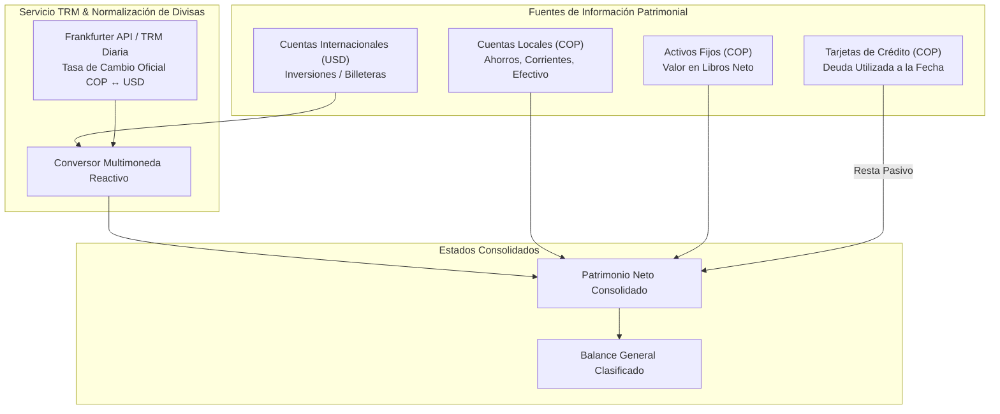

---

## 📈 Métricas y Calidad del Código

* **Total de Archivos del Proyecto:** **500 archivos**
* **Archivos Kotlin (`.kt`):** **438 archivos**
* **Líneas de Código Kotlin:** **115,819 líneas netas**
* **Módulos Gradle Desacoplados:** **7 módulos** (`:app`, `:core-model`, `:core-database`, `:feature-activos`, `:feature-ocr`, `:feature-informes`, `:feature-objetivos`)
* **Tablas de Base de Datos:** **31 entidades relacionales** en Room v30
* **DAOs Criptográficos:** **11 interfaces DAO** con consultas reactivas (`Flow`)
* **Índices de Alto Rendimiento:** Índices compuestos en `accounts(userId)`, transacciones y bitácoras de auditoría de activos.
* **Cobertura de Pruebas Unitarias:** Pruebas automatizadas en [`FinancialReportsEngineTest.kt`](file:///C:/Users/Hawk/Documents/AppsFinanzas/kashapp-secure-auth%20V7.9/feature-informes/src/test/java/com/example/feature/informes/FinancialReportsEngineTest.kt) (ecuación patrimonial y coherencia contable), [`DepreciationEngineTest.kt`](file:///C:/Users/Hawk/Documents/AppsFinanzas/kashapp-secure-auth%20V7.9/feature-activos/src/test/java/com/example/feature/activos/calculator/DepreciationEngineTest.kt) (depreciación NIC 16) y [`CreateTransferUseCaseTest.kt`](file:///C:/Users/Hawk/Documents/AppsFinanzas/kashapp-secure-auth%20V7.9/app/src/test/java/com/example/CreateTransferUseCaseTest.kt) (atomicidad en transferencias).

---

## 🚀 Guía de Instalación y Ejecución Local

### Prerrequisitos
* **Android Studio:** Ladybug (2024.2.1) o superior.
* **JDK:** Java Development Kit 17 (OpenJDK 17).
* **Android SDK:** API Level 34 (Android 14) instalado con SDK Build Tools 34.0.0.
* **Gradle:** Versión 8.7+ con soporte de Gradle Wrapper.

### Pasos de Configuración

1. **Clonar el Repositorio Oficial:**
   ```bash
   git clone https://github.com/Andrewsscorp/KashAPP.git
   cd KashAPP
   ```

2. **Configuración de Google Services (Firebase):**
   * Copia la plantilla de ejemplo de configuración en el módulo `:app`:
     ```bash
     cp app/google-services.json.example app/google-services.json
     ```
   * *Aviso de Seguridad:* El archivo `app/google-services.json` con credenciales reales de producción está estrictamente excluido por `.gitignore`. Puedes vincular tu propio proyecto de Firebase Console para desarrollo local.

3. **Variables de Entorno (Opcional para Asistentes IA):**
   * Si deseas habilitar las sugerencias de inteligencia artificial avanzadas, crea un archivo `.env` en la raíz del proyecto:
     ```properties
     GEMINI_API_KEY=tu_clave_de_gemini_api_aqui
     ```

4. **Compilación y Despliegue:**
   * Abre la carpeta del proyecto en Android Studio.
   * Ejecuta la sincronización de dependencias de Gradle (*File > Sync Project with Gradle Files*).
   * Conecta un dispositivo físico Android (con depuración USB habilitada) o inicia un emulador con API 26 o superior.
   * Ejecuta la aplicación presionando el botón **Run** (`Shift + F10`).

---

## 🛡️ Políticas de Privacidad y `.gitignore`

KashApp implementa un estándar intransigente de protección de secretos en el control de versiones:
* ❌ **Credenciales de Nube:** `google-services.json`, archivos de cuentas de servicio de Firebase y registros de depuración están bloqueados de raíz.
* ❌ **Bases de Datos Locales:** `*.db`, `*.db-shm`, `*.db-wal`, `*.sqlite`, `*.bak`, `*.sql` y directorios de copias de seguridad de pruebas están excluidos de los commits.
* ❌ **Claves y Certificados:** Archivos `.jks`, `.keystore`, `.pem` y `.key` jamás se incluyen en el repositorio.
* ❌ **Propiedades Locales:** Rutas del SDK local en `local.properties` y variables de entorno `.env` permanecen en la máquina del desarrollador.

---

## 👨‍💻 Autor y Créditos

* **Arquitecto de Software & Desarrollador Principal:** **Andres Felipe Suarez** ([@Andrewsscorp](https://github.com/Andrewsscorp))
* **Organización:** AndrewsCorp Engineering Team
* **Repositorio Oficial:** [https://github.com/Andrewsscorp/KashAPP](https://github.com/Andrewsscorp/KashAPP)

---
<div align="center">
  <sub>KashApp — Diseñado con rigor de ingeniería bancaria, excelencia arquitectónica y devoción por la privacidad.</sub>
</div>
