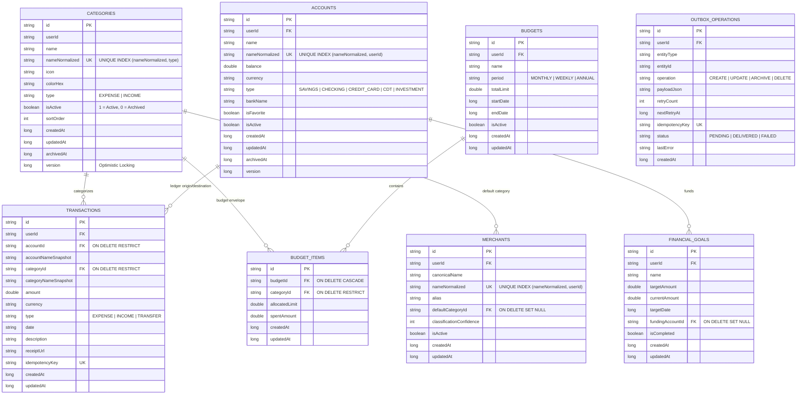
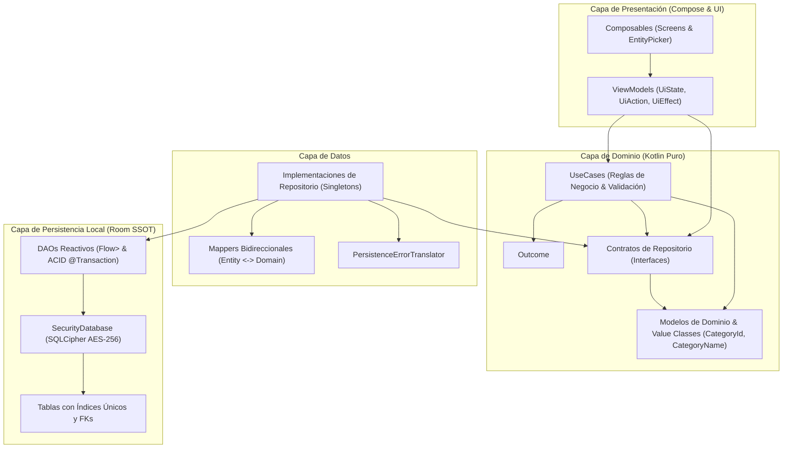
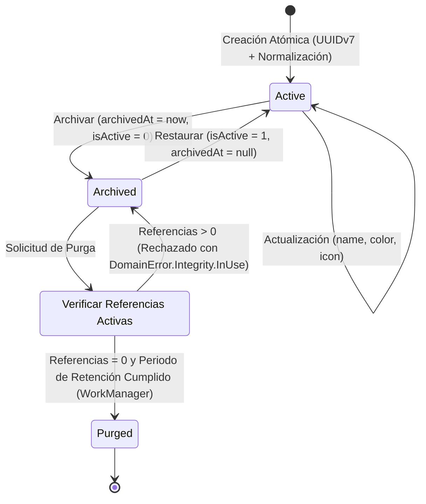

# Especificación de Arquitectura de Datos y Diagramas de Sistema

## 1. Diagrama Entidad-Relación Objetivo (Mermaid ER)

## 2. Grafo de Dependencias entre Capas

## 3. Máquina de Estados del Ciclo de Vida de Entidades

